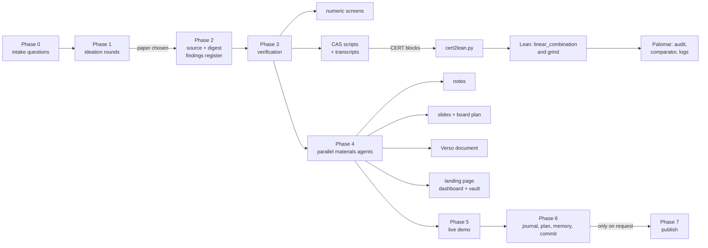

# Seminar deep study

**A Claude Code skill that prepares a research seminar talk as a deep study of one paper**: it
helps you choose the paper in an interactive discussion, then re-checks the paper's computations
with computer algebra, formalizes its logic in Lean, records what it finds in the paper, and
builds the notes, slides, board plan, live demo, landing page and knowledge base from one
verified source of truth.

## What it is

You ask for a seminar topic, or you bring a paper. The agent then works with you through seven
phases:

1. **Intake.** A few compact questions: the audience, the length and the date; the board,
   computer and live demo; the depth; your computer algebra system (CAS) and where it runs; where
   heavy computations run; which deliverables you want; whether the dashboard stays on your machine
   or goes online, and where; and git.
2. **Topic ideation.** If you have no paper yet, the agent builds a profile of your interests from
   your arXiv record and current projects. It scans recent preprints and code repositories,
   verifies every candidate at the source, and discusses a shortlist with you over as many rounds
   as you need.
3. **Digest.** The paper is rewritten for the seminar. Every claim carries a tag saying how it was
   checked: `[Lean]`, `[CAS]`, `[num]`, `[exp]` or `[paper]`. A **findings register** collects what
   the checks turn up, with severities: confirmed, wording, implicit hypothesis, strengthening,
   error.
4. **Verification.** Numeric screens, CAS scripts with committed transcripts, and certificates
   found by the CAS and checked in Lean (`linear_combination`). Lean's own automation (`grind`)
   re-proves the same steps with no certificate. The formalization can go up to the Palomar
   registry format: `Challenge.lean`, `Solution.lean`, `comparator.json`, only the three standard
   axioms, deep standard facts as explicit hypotheses, an axiom audit, and `lake comparator`
   checked by six kernels.
5. **Materials, built by parallel agents.** Notes as a Jupyter Book whose numbers are computed at
   build time. A reveal.js deck that refuses code that is not a verbatim excerpt of your sources and
   works offline. A board plan with minute marks. A Verso document compiled against the
   formalization. A landing page and dashboard with a computed header image. An Obsidian vault.
6. **Live demo.** A Lean file that runs in seconds, locally or on a cluster: the main theorem and
   its axioms, a certificate checked live, the same fact by `grind`, and a variant you break on
   purpose.
7. **Publishing,** only when you ask: a private Claude artifact, GitHub Pages, or your own web
   server through an allow-list deploy script with a dry run, a link check and a leak scan.

Throughout, the project keeps `CLAUDE.md`, `MEMORY.md`, `JOURNAL.md`, `PLAN.md` and
`MAINTENANCE.md`, so that any later session, or you alone, can resume it.

## Why it goes beyond reading a paper

A seminar talk usually rests on a careful reading. This skill turns it into a **deep study**:

- **Paper validation.** Every computational claim is re-done, every "one checks" is checked, and
  every disagreement lands in a findings register with evidence that someone else can re-run. In
  practice this finds wrong reasons given in proofs, hypotheses used without being stated, results
  that hold more generally than stated, and typos in explicit lists.
- **Lean formalization.** The paper's logic is checked by a proof assistant, at a depth you
  choose: from key statements up to a complete development in the Palomar registry format, with
  the hard but standard background facts as explicit, visible hypotheses.
- **Computer algebra under control.** The CAS finds identities; Lean checks them. Nothing is
  trusted from the CAS: a wrong certificate fails to compile. A second route, Lean's `grind`,
  shows how far internal automation reaches.
- **One source of truth.** The notes, slides, Verso document and page quote the digest, the logs
  and the transcripts; numbers are computed, never typed. A materials agent that disagrees with
  the digest reports it, and the digest is corrected.

The talk becomes a lesson in the mathematics, a lesson in formalization, and a demonstration of
how mathematics can be done with today's tools, while staying understandable to mathematicians who
never used Lean.

## The interactive ideation discussion

Choosing a paper is a conversation, not a form. Each round has the same shape:

1. **Profile**: the agent states in three lines what it thinks your interests are (from your arXiv
   record, your current projects and what you said), so that you can correct it.
2. **Search, in parallel**: web news, an arXiv API scan over your categories and a recency window,
   code repositories (size, toolchain, which tactics carry the proofs), page counts from the PDFs.
3. **Verify**: ids, authors, dates, versions, pages, code links, and a quick independent check of
   anything spectacular. Company or press claims are labelled as claims.
4. **Present**: a prose shortlist with one recommendation, why it fits you and the format, two or
   three alternatives, papers just outside your filters, news worth five minutes, and the sources.
5. **Listen**: "not convinced", "more recent", "closer to my research" each start a new round
   with a refined profile. Every candidate and the reason it was dropped go into the journal.

In the first use, four rounds in one afternoon moved from "a recent Lean preprint for an algebraic
geometry group" to a ten-page algebraic geometry paper close to the speaker's own research. That
paper was then formalized and re-verified before the talk.

## The pipeline



## Using it in mathematics

Typical scenarios:

- *An algebraic geometry preprint with explicit equations* (curves on a surface, a pencil, a
  configuration): re-derive the equations in Magma or Sage, screen the explicit list numerically,
  formalize the counting theorem in Lean with CAS certificates, keep the cohomological input as
  explicit hypotheses, and draw the header image from the computed configuration.
- *A number theory paper with a computer search*: re-run the search, certify the small cases in
  Lean (`decide`, `norm_num`), and check every table entry against the transcript.
- *A combinatorics or discrete geometry paper*: re-run the enumeration, check the extremal
  examples, and formalize the key lemma.
- *A paper about formalization or automation itself*: inspect its repository (toolchain, size,
  which tactics carry the proofs), reproduce one result live, and explain the tactic's mathematics
  (normal forms, Nullstellensatz and Positivstellensatz certificates, completion procedures).

## Using it in computer science

The same phases apply; `references/computer-science.md` maps them:

- *An algorithms paper with a new bound*: formalize the key invariant or potential-function lemma
  in Lean, run the implementation on adversarial inputs, and check the claimed scaling
  empirically (never as a proof by plot).
- *A programming-languages paper*: mechanize progress and preservation for the core calculus, run
  the artifact's test suite, and check the paper's examples against the implementation.
- *A verification, SAT or SMT paper*: re-run the solvers, check their certificates (DRAT or LRAT
  proofs, models, unsat cores), and measure on the stated benchmark subset.
- *A machine-learning theory paper*: check the inequalities symbolically and numerically,
  reproduce the small experiments with recorded seeds, and formalize the elementary lemma.

## What you get in your project

| path | content |
|---|---|
| `CLAUDE.md`, `MEMORY.md`, `JOURNAL.md`, `PLAN.md`, `MAINTENANCE.md` | how the project is run and resumed |
| `source/SOURCE.md` | the paper's citation, version and checksums (the PDF itself is not committed) |
| `artifacts/mathematical/digest.md` | the paper rewritten, claims tagged, the findings register |
| `artifacts/computational/` | numeric screens |
| `cas/`, `cas/out/` | CAS scripts and transcripts |
| `formal/` | the Lean project (light, or Palomar format with audit and comparator) |
| `verso/` | the Verso document compiled against `formal/` |
| `book/`, `slides/`, `index.html`, `vault/` | notes, the deck and board plan, the landing page and dashboard, the knowledge base |

## Prerequisites (all optional)

Only Claude Code is required. Everything else is used when you choose it:

- **Lean 4** with elan and Mathlib, locally or on a SLURM cluster. Palomar needs Lean ≥ v4.35.0-rc2.
  Mathlib needs several GB of disk.
- **A CAS**: Magma (often on a remote licensed host), SageMath, SymPy or PARI/GP.
- **Python 3** with `uv` for the tools, the numeric screens and the notes. The skill's tools need
  only the standard library; `pypdf` is used for page counts when it is installed.
- **Jupyter Book 1.x** for the notes; **Verso** for the self-checking document; **reveal.js**,
  **MathJax** and **highlight.js** for the slides (vendored by a script, so the talk works
  offline); **Obsidian** to browse the vault; **Google Chrome** for headless screenshots and the
  layout check.
- **`gh`** for GitHub repositories and Pages; `rsync` and SSH for your own web server.

## Install

```bash
git clone <this repository's URL> seminar-deep-study
cd seminar-deep-study && ./install.sh          # links it into ~/.claude/skills/seminar-deep-study
```

`install.sh` creates a symbolic link and never deletes or overwrites anything:
`./install.sh --dry-run` shows what it would do, `--target DIR` links into another skills
directory (for example for another client that reads `SKILL.md`), and `--uninstall` removes the
link only if it points to this checkout. Update with `git pull`. Start a new Claude Code session
after installing, then either type `/seminar-deep-study` or just describe what you need:

> I give a 90-minute talk at our algebraic geometry seminar in two weeks. Find me a recent short
> preprint close to my research, and let's study it properly: notes, slides, and as much Lean as
> is reasonable.

More openers are in `examples/prompts.md`.

## Privacy model

- **Findings are confidential by default.** A findings register about someone else's unpublished
  paper stays in your project until you decide; for a real error the skill suggests telling the
  authors first. Nothing goes into a public page, repository or shared skill without your consent.
- **Outward actions need an explicit request in the same session**: deploying, pushing, creating
  repositories, publishing artifacts. Dashboards start local or private.
- **No secrets in files**: SSH uses your keys or agent; passwords and tokens never enter the
  project. `tools/leak_scan.py` checks a tree for secrets and for any strings you list (user names,
  hosts, home paths, private project names) before you publish it.
- **Two editions.** The author keeps a private edition of this skill with the author's own infrastructure
  (website deployment, cluster and CAS hosts, research profile), in a private repository. This
  public edition is generated from it, scanned for leaks, and contains none of those details.
  Neither edition contains findings about any particular paper.

## Repository layout

```
SKILL.md                 what the agent reads when the skill triggers (phases, principles)
references/              read on demand: intake, ideation, digest, verification, Lean/Palomar,
                         compute, materials, live demo, documentation, publishing, CS, traps
templates/               copied into projects by tools/scaffold.py: project docs, digest, Lean
                         (Palomar), cluster driver, CAS runner and emitters, site, slides, book,
                         Verso, vault, and the briefs for subagents
tools/                   scaffold.py, arxiv_scan.py, tactic_census.py, cert2lean.py, leak_scan.py
examples/                opening prompts, a sample certificate transcript and its Lean output
tests/                   consistency tests (python3 -m unittest discover -s tests)
install.sh               symlink installer
```

## License

Apache License 2.0 (`LICENSE`). © 2026 Bartosz Naskręcki.
